<h1 align="center">
  
</h1>

<p align="center">
  <a href="https://github.com/nityanand123gupta?tab=repositories"></a>
  <a href="https://github.com/rungtaventures1"></a>
  
</p>

---

## 👨‍💻 About me

I'm a Computer Science undergrad at **IIIT Hyderabad** who likes problems that
touch real hardware and real users. Most of my time splits three ways:

- 🚁 **Computer vision for airspace security** — camera-only drone/bird detection at
  [**Rungta Ventures**](https://github.com/rungtaventures1). No radar, no RF, no acoustics:
  just pretrained UAV YOLO models, a ByteTrack-style tracker, flight-pattern confirmation to
  veto bird false-alarms, and CLAHE weather preprocessing for fog, haze and snow-glare.
- 🧱 **Full-stack products** — Next.js 16 / TypeScript / Drizzle / Clerk / Postgres apps
  built end-to-end, from schema to deploy.
- ⚙️ **Distributed systems** — MPI, MapReduce, gRPC and P2P coursework at IIIT-H, written in
  C++ and Python.

```yaml
name:      Nityanand Gupta
school:    IIIT Hyderabad — B.Tech Computer Science
focus:     [computer vision, distributed systems, full-stack]
building:  camera-only drone detection · ed-tech products · agentic AI tooling
toolbelt:  [TypeScript, Python, C++, React, FastAPI, Next.js, YOLO, Postgres]
offline:   [chess ♟️, guitar 🎸, horse riding 🐎]
```

---

## 🚀 What I'm building

### 🛰️ Airspace & computer vision

| Project | What it does |
|---|---|
| **[sky-watch-drone-zones](https://github.com/nityanand123gupta/sky-watch-drone-zones)** | Camera-only drone/bird monitor for border & perimeter scenarios. Restricted-airspace ROI zones, Critical/Warning/Normal threat grading, border line-crossing, loitering alerts, acknowledgeable alert feed, event log + CSV export. **FastAPI + React.** |
| **[sky-watch-drone-monitor](https://github.com/nityanand123gupta/sky-watch-drone-monitor)** | Multi-camera variant of the same pipeline — live annotated RTSP streams, per-camera drone/bird counts and activity charts. |
| **RV AirGuard · RV SkyShield** `private` | Productionised versions of the above for [Rungta Ventures](https://github.com/rungtaventures1) — Zone Intelligence, packaged Windows installers, multi-site airspace monitoring. |

### 🤖 AI & agents

| Project | What it does |
|---|---|
| **[ai-sports-trade-analyzer](https://github.com/nityanand123gupta/ai-sports-trade-analyzer)** | Multi-agent NBA trade analyzer: a Scout / Quant / Cap / GM crew reasoning over a player-value model and a **CBA salary-cap rules engine**, producing a graded recommendation. Built with CrewAI + Gemini/Claude, taught cell-by-cell across two notebooks with a full `DESIGN.pdf` write-up. |

### ⚙️ Distributed systems & coursework

| Project | What it does |
|---|---|
| **[ds-hw3-team32](https://github.com/nityanand123gupta/ds-hw3-team32)** | Single-source shortest paths over **MapReduce**, plus a food-ordering service on **gRPC**. |
| **Napster with reliable file transfers** `private` | P2P file sharing with a central index and reliability guarantees over lossy links. |
| **MPI assignment set** `private` | Bitonic sort, connected components and server-log analytics in **C++ with MPI**. |

### 🧱 Products & web

| Project | What it does |
|---|---|
| **[felicity-event-management](https://github.com/nityanand123gupta/felicity-event-management)** | Event management platform built for IIIT-H's **Felicity** fest. |
| **StudyMint · GetAssignment** `private` | Academic assignment-support platforms — Next.js 16, Drizzle ORM, Clerk auth, Postgres. |
| **Buddyly · YouthGenHealth · Relationship OS** `private` | TypeScript product work across social, health and CRM surfaces. |

---

## 🧰 Tech I use

**Languages**


**Frontend**


**Backend & data**


**ML, CV & systems**


**Tooling & infra**


---

## 📊 GitHub stats

<p align="center">
  
  
</p>

<p align="center">
  
</p>

<p align="center">
  
</p>

<p align="center">
  
</p>

---

## 📌 Pinned projects

<p align="center">
  <a href="https://github.com/nityanand123gupta/sky-watch-drone-zones"></a>
  <a href="https://github.com/nityanand123gupta/ai-sports-trade-analyzer"></a>
</p>
<p align="center">
  <a href="https://github.com/nityanand123gupta/sky-watch-drone-monitor"></a>
  <a href="https://github.com/nityanand123gupta/ds-hw3-team32"></a>
</p>

---

## 🐍 Contribution snake

<picture>
  <source media="(prefers-color-scheme: dark)" srcset="https://raw.githubusercontent.com/nityanand123gupta/nityanand123gupta/output/github-contribution-grid-snake-dark.svg" />
  
</picture>

---

## 🤝 Connect

<p align="center">
  <a href="https://github.com/nityanand123gupta"></a>
  <a href="mailto:hr@rungtaventures.ai"></a>
</p>

<p align="center"><i>Off the keyboard: chess ♟️ · guitar 🎸 · horse riding 🐎</i></p>
