  

  
  
  
  
  

  
  
  

---

##  Profile

Computer Science at **IIIT Hyderabad**, working across **machine learning**, **agentic AI**,
**full-stack** and **systems**. I like building the whole thing — model pipeline, database
schema, operator interface and deploy — rather than one slice of it.

Most of my work falls into three areas. **Agentic AI and applied ML**: multi-step LLM
pipelines that plan their own analysis and write the code to run it, retrieval systems over
real document corpora, and agent crews that reason against hard rule engines. **Full-stack
products**: TypeScript and Postgres on Next.js 16, built end to end and shipped.
**Detection and monitoring systems**: deep-learning detectors with multi-object tracking,
motion-pattern verification and image preprocessing for degraded conditions, packaged to run
fully offline.

Alongside that I ship fixes upstream into widely-used open-source infrastructure.

---

##  Merged upstream contributions

Fixes and features merged into open-source projects used in production worldwide —
**28,000+ combined stars**.

| Project | Stars | What I shipped |
|---|---:|---|
| **[django-oauth/django-oauth-toolkit](https://github.com/django-oauth/django-oauth-toolkit)**  OAuth2 provider for Django | 3.3k | Brought authorization **error** redirects into **RFC 9207** compliance by emitting the `iss` issuer identifier on the failure path, not just on success — so clients in multi-provider deployments can attribute which server rejected them. [#1847](https://github.com/django-oauth/django-oauth-toolkit/pull/1847) |
| **[evilmartians/lefthook](https://github.com/evilmartians/lefthook)**  Git hooks manager | 8.9k | Made `lefthook run` **fail loudly** when `--job` or `--command` matches nothing, replacing a silent no-op that let mistyped filters pass as a green run. [#1512](https://github.com/evilmartians/lefthook/pull/1512) |
| **[faker-js/faker](https://github.com/faker-js/faker)**  Fake-data generation for JS/TS | 15.5k | Closed an **API contract gap** in `weightedArrayElement` — documented the error it throws, so consumers handle the failure path instead of discovering it at runtime. [#4016](https://github.com/faker-js/faker/pull/4016) |

---

##  Selected work

###  Applied AI & agent systems

| System | Detail |
|---|---|
| **Multi-agent analytics pipeline**  `proprietary` | Eight-stage LLM pipeline over enterprise spreadsheets: ingests workbooks, infers schema and cross-dataset relationships, proposes candidate analyses, plans an execution strategy, then **generates and runs the Python analysis code** — a full question-to-result loop with no analyst in the middle. |
| **Financial RAG system**  `proprietary` | Retrieval-augmented analysis over financial reports. PDF extraction and chunking with metadata preserved, **FAISS** semantic search over sentence-transformer embeddings, and a router that reaches for external industry benchmarks only when the local corpus can't answer. Every claim cites its source down to the PDF page. |
| **AI Sports Trade Analyzer**  `public` | Multi-agent NBA trade analyzer — a Scout / Quant / Cap / GM agent crew reasoning over a player-valuation model and a **CBA salary-cap rules engine** to produce a graded recommendation. CrewAI + Gemini/Claude, with a full architecture write-up in `DESIGN.pdf`. |

###  Product engineering

| System | Detail |
|---|---|
| **StudyMint** `private` | Study-support platform for university students — Next.js 16, Drizzle ORM, Clerk auth, Postgres. Built end to end from schema to deploy. |
| **Buddyly**  `live · buddyly.ai` | TypeScript product platform with **DigiLocker** identity verification. Shipped venue search, consent-flow and DigiLocker redirect fixes across a full QA cycle, and removed the row cap on bulk data export. |
| **Relationship OS** `private` | TypeScript + PLpgSQL CRM. Delivered a UI, performance and reliability overhaul with Daily Lineup, an AI-budget fix, test fixtures and CI. |

###  Detection & monitoring systems

| System | Detail |
|---|---|
| **Zone Intelligence**  `proprietary` | Fuses a camera fleet into **one air picture**. A single camera can only report a bearing — Zone Intelligence resolves the object seen by multiple cameras into a single track with position, heading and speed, then grades that track against the site's surveyed perimeter. |
| **AirGuard** · **SkyShield**  `proprietary` | Camera-only drone-vs-bird detection for border and perimeter sites — **no radar, RF or acoustic sensors**. Pretrained UAV detection models with multi-object tracking, flight-pattern confirmation that vetoes the classic bird false-alarms, and CLAHE preprocessing for fog, haze and snow-glare. Operator dashboard, shipped as packaged Windows installers that run **fully offline**. |
| **SiteGuard**  `proprietary` | Ground-side site monitoring over ONVIF/RTSP camera fleets — detection and tracking of people, vehicles and animals, directional line-crossing counts, zone dwell and loitering alerts, and a camera wall that scales to the full fleet. **FastAPI + React.** |

---

##  Engineering stack

**Core areas**

**Languages**

**Machine learning & AI**

**Backend & data**

**Frontend**

**Infrastructure & tooling**

---

##  Engineering activity

  
  

  

---

##  Featured repositories

  
  

  

---

##  Contribution graph

<picture>
  <source media="(prefers-color-scheme: dark)" srcset="https://raw.githubusercontent.com/nityanand123gupta/nityanand123gupta/output/github-contribution-grid-snake-dark.svg" />
  
</picture>

